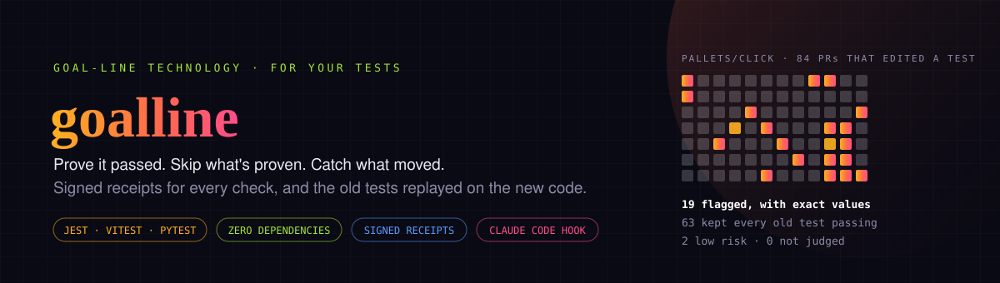
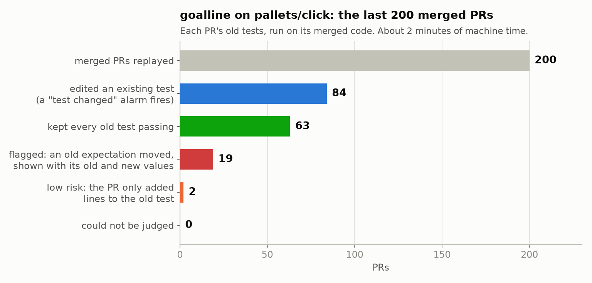
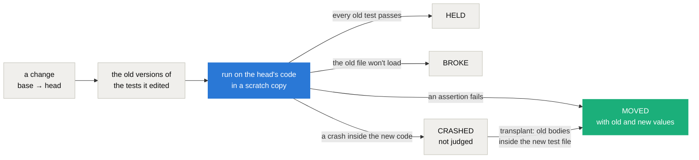

<div align="center">



# goalline — goal-line technology for your tests

**Your coding agent made the tests pass. Did it fix the code, or the tests? goalline replays the old tests on the new code and shows every expectation that moved, with its exact old and new values. It also keeps a signed receipt for every check, so nothing that already passed on this exact code has to run again.**

[](https://github.com/marketplace/actions/goalline-catch-ai-edited-tests)
[](LICENSE)
[](https://nodejs.org/)
[](package.json)
[](#vitest-and-pytest)
[](#stopping-an-agent-that-moved-a-goalpost)

[Website](https://intikhab49.github.io/goalline/) · [Why](#why) · [Quick start](#quick-start) · [GitHub Action](#github-action) · [What it does](#what-it-does) · [Benchmark](#benchmark) · [How goalpost works](#how-goalpost-works) · [Commands](#commands) · [FAQ](#faq) · [Limits](#limits)

</div>

---

## Why

Coding agents are known to change the test instead of fixing the code. [ImpossibleBench](https://arxiv.org/abs/2510.20270) (Zhong, Raghunathan and Carlini, 2025) puts it plainly: *"an LLM agent with access to unit tests may delete failing tests rather than fix the underlying bug"*. Their benchmark gives agents tasks whose tests contradict the spec, so any pass is a shortcut, and it catches cheating that ranges *"from simple test modification to complex operator overloading"*.

When a change edits the code and its test in the same diff, the suite passes either way. A green check can't tell you whether behaviour changed. goalline can. It runs the **old** version of every test the change edited against the **new** code. If an old test now fails, behaviour changed and the test was rewritten to match, and you see exactly what moved: `Expected 5, received 6`, or pytest's own `assert 6 == 5 (where 6 = add(2, 3))`.

## Quick start

Node 20+ and git, nothing else. Run it from a checkout whose dependencies are installed:

```sh
# What would it have flagged on your last 200 merged PRs? (writes goalline-history/report.md)
npx github:intikhab49/goalline history --from-git -- npx jest {files}
#   Vitest:  -- npx vitest run {files}
#   pytest:  -- python -m pytest {files}   (with the project's virtualenv active)

# One change, before you merge it: old tests on the new code
npx github:intikhab49/goalline goalpost --base origin/main -- npx jest {files}

# Or install the command once
npm install -g github:intikhab49/goalline
goalline help
```

## GitHub Action

Run goalpost on every pull request ([on the GitHub Marketplace](https://github.com/marketplace/actions/goalline-catch-ai-edited-tests)). Its card (what needs a look, with the old and new values) goes on the job's summary page.

```yaml
name: goalline
on: pull_request
jobs:
  goalpost:
    runs-on: ubuntu-latest
    steps:
      - uses: actions/checkout@v4
      - uses: actions/setup-node@v4
        with:
          node-version: 20
      - run: npm ci
      - uses: intikhab49/goalline@v0
        with:
          command: npx jest {files}
```

| Input | Default | What it does |
|---|---|---|
| `command` | required | The test command, with `{files}` where the test files go: `npx jest {files}`, `npx vitest run {files}`, `python -m pytest {files}` |
| `check` | `goalpost` | `goalpost` runs the old tests on the new code; `prove-red` runs the new tests on the old code |
| `base` | the pull request's base branch | The ref to compare against |
| `cwd` | the repository root | The folder the tests run in, for a monorepo |
| `tests` | the runner's usual file names | Globs that say which files are tests |
| `fail-on-flag` | `true` | Fail the step when something is flagged |

Outputs: `flagged` (`true` or `false`) and `report` (the path of the Markdown card). The action fetches the history it needs, so the default shallow checkout is fine. For pytest, set up Python and install the project (`pip install -e .` and pytest) before the step.

## What it does

| | Commands | What you get |
|---|---|---|
| **Prove** | `run` · `verify` | A signed receipt every time a check runs, tied to the exact code it ran on (the git tree). `verify` says which gates already passed on this code without re-running anything. Each receipt records whether the machine was idle, whether the code changed during the run, and which build a browser suite tested. |
| **Skip** | `run --reuse` · `--rules` · `trial-report` | Skip a gate this exact code already passed. With rules, also carry a pass over changes that can't affect the gate: a trial first, trusted only once it agrees, with the time saved reported. |
| **Catch** | `goalpost` · `prove-red` · `guard` · `history` | Old tests on new code, so a moved expectation shows up with its values. New tests that must fail on the old code first, or they prove nothing. A Claude Code Stop hook that won't let the agent finish until it explains a moved test. And all of it replayed on your last 200 merged PRs. |

Jest, Vitest and pytest are judged test by test; any other command is judged file by file, by its exit code. Zero dependencies.

## Benchmark



`goalline history` on [pallets/click](https://github.com/pallets/click): its last 200 merged PRs (up to 2026-10-04), each judged on its merge commit, with pytest 9.0.2 on Python 3.11.

| | PRs |
|---|---|
| Merged PRs replayed | 200 |
| Edited an existing test (a "test changed" alarm fires on every one) | 84 |
| Kept every old test passing | **63** |
| Flagged: an old expectation moved, shown with its old and new values | **19** |
| Low risk: the old test fails, but the PR only added lines to it | 2 |
| Could not be judged | 0 |
| Machine time | about 2 minutes |

A flag is not a bug report. click's maintainers changed behaviour on purpose and updated the tests to match: in [#3239](https://github.com/pallets/click/pull/3239), a `--flag` option with `prompt=True, default=True, flag_value=False` went from `Flag [y/N]:` (Enter gives `False`) to `Flag [Y/n]:` (Enter gives `True`), with three lines of a test table edited to match, and all 11 CI checks green. That is the point: a reviewer sees the change and its values, not just a green check. Judged as first opened as well (`--first-heads`, 199 PRs), no PR edited a test to hide a change that review then took back.

To reproduce it, clone click, install it and pytest into a virtualenv, activate it, and run:

```sh
npx github:intikhab49/goalline history --from-git --limit 200 -- python -m pytest {files}
```

## How goalpost works



The scratch copy is a clean export of the head commit, using your checkout's installed packages without copying them. Nothing in your checkout changes.

## Commands

```sh
# Run a gate and keep a receipt (exits with the command's own exit code)
goalline run --gate api-unit -- npx jest
goalline run --gate browser --count 'http429="statusCode":429' -- npx playwright test

# Which gates are already proven for the code in this checkout? Nothing is re-run.
goalline verify --require api-unit,web-unit,browser:2 --idle browser

# Old tests vs new code / new tests vs base code (Jest, Vitest and pytest give per-test results)
goalline goalpost  --base origin/main --cwd apps/web -- npx jest {files}
goalline prove-red --base origin/main --cwd apps/web -- npx jest {files}
goalline goalpost  --base origin/main -- npx vitest run {files}
goalline goalpost  --base origin/main -- python -m pytest {files}

# What goalpost would have flagged on the last 200 merged PRs (resumable; writes report.md)
goalline history --cwd apps/web -- npx jest {files}

goalline show <receipt.dsse.json>   # print one receipt and check its signature

# Tidy the store: receipts that can never prove anything, plus any that match every filter given
goalline prune --older-than 30d --dry-run

# Tests that need a database: each run gets its own, set up in the scratch copy and dropped after
goalline prove-red --base origin/main --cwd apps/api \
  --fresh-db 'DATABASE_URL=postgresql://app@localhost:5432/{db}' \
  --setup 'createdb {db} && npx prisma migrate deploy' --teardown 'dropdb {db}' \
  -- npx jest --config ./test/jest-e2e.json --runInBand {files}
```

A setup that fails judges nothing (never a red or a green), and the teardown always runs. Only the variable name of `--fresh-db` goes on the receipt: its url can hold a password.

`prune` never deletes a failed or flagged run just because a later run on the same code passed: that is the record that the gate was flaky.

`goalpost` and `prove-red` exit 2 when they flag something (`--no-fail` to always exit 0). Each one also prints a Markdown summary ready to paste as a PR comment.

goalpost's comment sorts what changed by how much a reviewer is needed. **Needs a look** is an old test whose lines the change removed or rewrote, with the exact old and new values. **Low risk** is an old test the change only added lines to (a list that grew, a mock that was added), so every old line is still there. An added early `return`, dead branch, skip or focus never counts as low risk. Then come the files not judged, and how many held.

An old test file that only fails to *compile* against the new types (Jest + ts-jest: a fixture missing a new field, a changed signature) says nothing about behaviour. So `goalpost` runs it again under the project's own Jest config, the one the command names with `--config` or else the default, with ts-jest's type check off. It then gets a real verdict, HELD or MOVED, with the compile error noted. A missing module or export is not retried: there the code under test was deleted or moved. `--no-retry-untyped` turns this off.

An old test that fails only by crashing *inside the new code* is **CRASHED**: a TypeError or ReferenceError whose first project frame is not a test file. Its fixtures or mocks lack something the new code now needs, so it never reached its expectations, and it is reported as not judged instead of as a behaviour change. A crash inside the test itself stays MOVED, because there the result the code returns changed shape.

A CRASHED file that was edited (or renamed and edited) then gets the **assertion transplant** (`--no-transplant` to skip it). The *new* test file runs with its own imports, fixtures, mocks and setup, but each test that kept its full title (describe titles included) gets its *old* body back, and every other test is skipped. The old expectations then meet the new code with setup that fits it. If they still pass, the verdict is HELD. If one fails, it is MOVED with the exact values, for example `Expected 5, received 7` where the old file only crashed on a missing mock. An old body that names something the new file no longer has proves nothing, and the file stays CRASHED. Tests are found by a small built-in scanner (strings, template literals, comments, regular expressions, JSX), so no parser is needed.

## Vitest and pytest

**Vitest** works as Jest does: `goalline` adds `--run` (never the watch mode) and Vitest's JSON reporter next to its usual output, and reads Vitest's wording (`expected 6 to be 5` becomes `Expected 5, received 6`). The assertion transplant works the same way. There is no type-check retry, because Vitest does not type-check.

**pytest** writes JUnit XML (`--junitxml`), and a test is named as in its node id after the file: `TestCart::test_total`, `test_add[2-3-5]`. The old and new values are pytest's own words, `assert 6 == 5 (where 6 = add(2, 3))`, since only the test knows which side is the expectation. One old file that no longer imports is BROKE without stopping the other files (`--continue-on-collection-errors`). CRASHED is a `TypeError`, `AttributeError`, `NameError` or `KeyError` raised in project code, not in a test file or `conftest.py`, or an old call the new signature refuses (a missing argument, an unexpected keyword): Python raises that one at the call, in the test, before the new code runs. Test files are `test_*.py`, `*_test.py` and `tests.py` by default (`--tests` to change), and prove-red brings a new `conftest.py` along with the new tests. The transplant is not built for pytest yet.

Run pytest with the Python that has the project's packages: activate the virtualenv first, or give its python by full path. `uv run pytest {files}` gives the scratch copy an environment of its own. The scratch copy's folder (and its `src` folder, when that holds Python code) goes first on `PYTHONPATH`, so a package installed with `pip install -e .` still tests the scratch copy, never your checkout.

## What it would have flagged on your own PRs

`goalline history` runs goalpost on the repository's merged pull requests, newest first (`--limit 200` by default). Each PR is judged on its merge commit against its first parent, so it sees the change exactly as it landed. `report.md` then shows, next to the number of PRs a "test file changed" alarm would fire on, how many PRs:

- need a look, with each old test that fails and its old and new values;
- were low risk only;
- kept every old expectation;
- could not be judged.

The PRs come from GitHub (`gh`, with the repository taken from the `origin` remote, or `--gh owner/name`). With `--from-git`, or when GitHub cannot be reached, they come from the merge commits instead ("Merge pull request #N ..." or a squash "Title (#N)"). With `--first-heads`, each PR is also judged as it was first opened, before review changed it: a catch that review fixed shows up there.

It runs one check at a time, and only while no other test runner is busy and enough memory is free (`--no-machine` skips that wait). A run can stop at any point and pick up again: `--max-minutes 8` pauses with exit 4, and the same command resumes from `results.jsonl`. `--plan` counts the PRs that would be judged without running anything. `--deps-root <dir>` installs each lockfile once, so old PRs run with their own packages. `--config <file.json>` covers several test areas (see the top of `src/history.mjs`).

## Stopping an agent that moved a goalpost

`goalline guard` runs goalpost on the work as it stands, uncommitted files included, against the base branch. As a Claude Code Stop hook it keeps the agent working while an old test expectation no longer holds: it exits 2, and its message, with the exact failing expectations, goes back to the agent. For each one the agent either restores the behaviour or records why the change is intended:

```bash
goalline guard --ack "src/cart.spec.ts::Cart applies the discount" --why "the task asks for the discount to apply before tax"
```

The reasons form the reviewer's ledger (`goalline guard --report` prints it as Markdown for the PR). Editing the test to match does not get past the guard, because it runs the *old* version of the test. Nothing in the checkout changes: the snapshot is a loose commit object. The guard never blocks because of its own failure, and after `--max-blocks` (default 3) identical blocks it lets the agent stop with a warning, so a stuck agent is never trapped.

In `.claude/settings.json` (the timeout is in seconds; a cold Jest run can take more than a minute):

```json
{
  "hooks": {
    "Stop": [
      {
        "hooks": [
          { "type": "command", "command": "goalline guard --hook --base origin/main --cwd apps/web -- npx jest {files}", "timeout": 600 }
        ]
      }
    ]
  }
}
```

## Not running what already passed

```sh
# Skip the gate when this exact code already passed it (two passes, one idle, for the browser suite)
goalline run --gate browser --reuse --reuse-runs 2 --reuse-idle -- npx playwright test

# Also carry a pass over changes that can't affect the gate. A trial until you trust it:
goalline run --gate api-unit --reuse --rules rules.json -- npx jest
goalline trial-report
goalline run --gate api-unit --reuse --rules rules.json --trust-rules -- npx jest
```

`rules.json` names areas of the repo and the areas each gate depends on. A changed file in no area at all (a lockfile, CI config, anything new) can affect every gate, so it re-runs everything. Gates named in `neverReuse` always run, even on the same code: later gates use what they make (`node_modules`, a compiled app), and a skipped one would leave them testing a missing or older build. With `outputs` listed, such a gate is reused on the same code only while what it made is still in place: the run fingerprints those files (a folder: every file under it), and a missing or changed one means it runs:

```json
{
  "neverReuse": ["npm-ci", "*build*"],
  "outputs": { "npm-ci": ["node_modules/.package-lock.json"], "web-build": ["apps/web/.next/BUILD_ID"] },
  "uses": { "browser": ["web-build"] },
  "ignore": ["**/*.md", "docs/**"],
  "areas": { "api": ["apps/api/**"], "web": ["apps/web/**"], "types": ["packages/**"] },
  "gates": { "api-*": ["api", "types"], "web-*": ["web", "types"] }
}
```

A gate that tests other gates’ builds (a browser suite starts the built app) names them in `uses`. Before it runs, the build on disk must be the one a passing run of that gate made from the same code, and it must not change during the run; otherwise the run is WARNED, says why, and `verify` does not count it. No more green browser runs on an old build.

In the trial, the gate always runs, and the log records whether carrying the earlier pass would have been right. `verify` ends with what to run, and only that (`Run only: browser (one passing run on an idle machine)`), or `Nothing to re-run`. `trial-report` says when the rules can be trusted: no disagreement in at least 20 would-be skips. Trusted, a carried pass writes a `CARRIED` receipt for the new code, and `verify` shows `CARRIED`, never `VERIFIED`. Only real runs are carried, never a carried receipt.

### What the code doesn't hold

A test run can pass because of the database it hit, not the code: a dev database that drifted, a migration that half-applied, another server version. Name it with `--input`, and goalline reads it right before and right after the gate and keeps a hash of it on the receipt:

```sh
goalline run --gate api --reuse --input db=pg -- npx jest apps/api
goalline verify --require unit,api --input db=pg
```

`db=pg` is the schema PostgreSQL reports for `$DATABASE_URL` (`pg_dump --schema-only`, without owners, grants and the lines that change on every dump) and the server's major version; `db=pg:TEST_DATABASE_URL` reads another variable. Any other probe is a command whose output says what matters, such as `--input db="sqlite3 dev.db .schema"` or `--input db="mysqldump --no-data --skip-dump-date app"`. In `verify` and `--reuse`, a receipt with inputs counts only while the same probe reads the same thing, and never when an input changed during the run. A password in a probe's URL never reaches the receipt. In `rules.json`, `"inputs": { "api-*": ["db"] }` says which gates depend on what, so a schema change doesn't re-run the unit tests.

## What a receipt is

An [in-toto](https://in-toto.io) statement of type [`test-result/v0.1`](https://github.com/in-toto/attestation/blob/main/spec/predicates/test-result.md) about one git tree, in a DSSE envelope signed with this machine's Ed25519 key (`~/.receipts/keys`). It records:
- what ran: command, exit code, test counts, failed test names, duration;
- the tree, the commit, the Node version, the OS, the lockfile digest, `TZ`/`CI`/`NODE_ENV`, and hashes of any env vars you name;
- the machine's state: whether the run was **idle**, meaning enough free memory and no other test runner during the run;
- the full log, gzipped next to the receipt.

Receipts are keyed by the **content** of the code (the git tree), not the commit. A run on uncommitted work therefore verifies once exactly that work is committed, and a merge whose result equals an already-tested tree is already proven.

A receipt only counts in `verify` if all of these hold:
- the signature is valid;
- the tree matches;
- the code didn't change during the run;
- the Node major version matches;
- the result is a clean pass (no failures, no flaky tests, no counted patterns such as rate-limit hits, and at least one test ran).

## Trust model

- **Tamper-evident, not forgery-proof.** Everyone on one machine shares one key, so an edited receipt fails verification, but anything running as your user can sign. Receipts catch honest mistakes: the wrong commit, uncommitted edits, a busy machine, a retried test. Unforgeable receipts need signing in CI with the job's own identity, which isn't built yet.
- **A receipt proves a run happened, not that the tests are good.** That's what `goalpost` and `prove-red` are for.
- **Nothing secret is stored.** Extra env vars are stored as hashes. No source code leaves the machine.

## FAQ

<!-- faq:start (docs/make_site.py writes this list) -->

### How do I know if an AI coding agent changed a test to make it pass?

Run the old version of every test the change edited against the new code. If an old test now fails, behaviour changed and the test was rewritten to match. `goalline goalpost` does exactly that and shows the old and new values, for example `Expected 5, received 6`.

### Why doesn't CI catch a test that was edited to pass?

Because CI runs the new tests on the new code. When a change edits the code and its test in the same diff, the suite passes either way, so a green check can't tell you whether behaviour changed.

### Is a flagged pull request a bug?

No. A flag means a person should look. Many changes move an expectation on purpose: on pallets/click, maintainers changed behaviour deliberately and updated the tests to match. goalline shows exactly what moved so the reviewer can confirm it was intended.

### Does goalline use AI or an LLM?

No. It runs your own test runner on two versions of your code and compares the results. No source code leaves the machine.

### Which test runners does goalline support?

Jest, Vitest and pytest are judged test by test. Any other command is judged file by file, by its exit code.

### How do I stop Claude Code from editing tests to pass?

Add `goalline guard --hook` as a Claude Code Stop hook. Before the agent may finish, the old tests it edited run against its work; a moved expectation sends it back to work until it restores the behaviour or records why the change is intended.

### How do I check that a new test actually tests the change?

Run it on the code before the change: it should fail there. `goalline prove-red` runs every test a change adds against the base code and flags any that already pass.

### Can CI skip tests that already passed on the same code?

Yes. `goalline run --reuse` keeps a signed receipt for every run, keyed by the git tree, and skips a gate that exact code already passed. With `--input db=pg`, a change to the database schema means it runs again.

### Does goalline catch hard-coded answers?

No. It catches tests that were edited, not code that special-cases the test's inputs. Hard-coded answers still need hidden tests or mutation testing.

### What does goalline cost, and what does it need?

It is free and open source (MIT). It needs Node 20 or newer and git, and has zero dependencies: `npx github:intikhab49/goalline help` runs it without installing anything.

<!-- faq:end -->

## Limits

- **Per-test results come from Jest, Vitest and pytest.** Any other runner is judged per file by its exit code.
- **New tests inside an edited file are found by their titles.** Tests with computed titles (`each`, template strings) are missed.
- **Scratch copies go in the temp folder** (`GOALLINE_SCRATCH` to move them). Never put them under a folder whose name starts with a dot: Jest configs whose `testMatch` starts with `<rootDir>` find no tests there.
- **Scratch copies link your checkout's `node_modules` instead of installing.** When the lockfile or setup files differ between base and head, the report says so, and a red can then be a setup error rather than a behaviour change.
- **Python packages come from the environment the command runs in**, not from the head's requirements or lockfile. `history --deps-root` installs npm lockfiles only.
- **The database counts only when you name it** (`--input db=pg`), and per gate, not per test. Env vars named in `--env-keys` are recorded but not checked, and the clock isn't part of the fingerprint yet.
- **`goalpost` catches edited tests, not hard-coded answers.** Hard-coded answers still need hidden tests or mutation testing.

## The old name

The command was called `receipts` before 0.10. That name still works, and so do `RECEIPTS_HOME`, `RECEIPTS_SCRATCH` and `RECEIPTS_DB`. What it signs is still called a receipt, and receipts live in `~/.receipts` (`GOALLINE_HOME` to move them).

## License

[MIT](LICENSE) © 2026 Intikhab Azam
